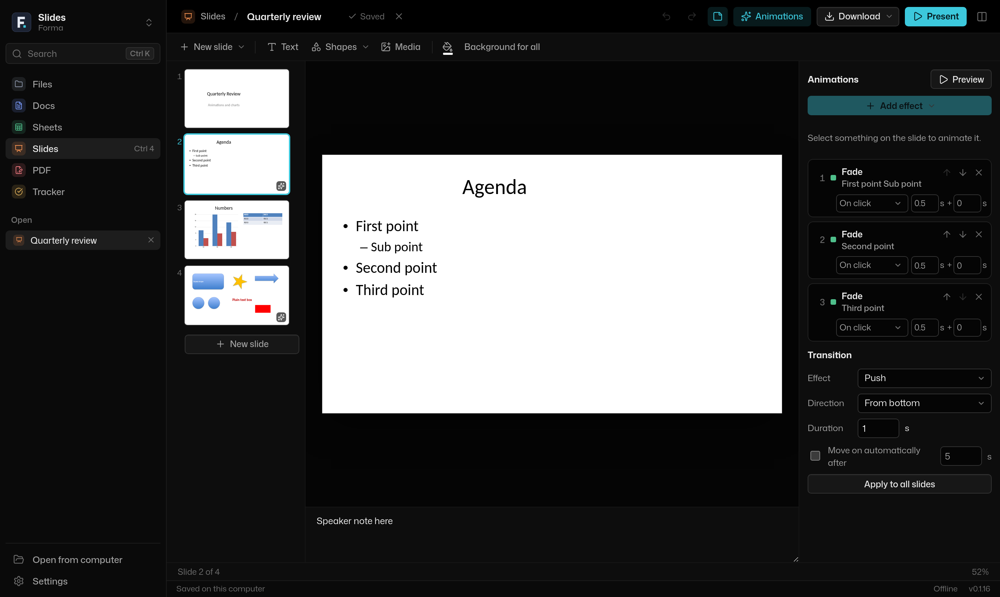

<div align="center">


# Forma

**Documents, spreadsheets, presentations and PDFs in one offline desktop app.**

Your files stay on your computer. No account, no subscription, no cloud.

[](https://github.com/Kingvic300/Forma/releases/latest)
[](https://kingvic300.github.io/Forma/)
[](LICENSE)

[**Download**](https://kingvic300.github.io/Forma/) · [Releases](https://github.com/Kingvic300/Forma/releases) · [Contributing](CONTRIBUTING.md)

<br>



</div>

<br>

## Why Forma

- **One app for everyday office work.** Write, calculate, present, and edit or sign PDFs without
  switching programs. Switch apps from the box in the top-left corner, or press `Ctrl+1` to
  `Ctrl+6`.
- **Opens the files you already have.** Word, Excel, PowerPoint, CSV, OpenDocument spreadsheets,
  PDF, HTML, Markdown and plain text, and saves back to the common formats.
- **Offline and private.** Nothing is uploaded. Forma uses the network only for the opt-in
  features under [Privacy](#privacy).
- **Free and open source.** MIT licensed, with signed automatic updates.

## Apps

| App | What you can do | Opens | Saves |
| :-- | :-- | :-- | :-- |
| **Files** | See everything you've made or opened, across all apps. | | |
| **Docs** | Write documents with headings, fonts, colors, lists, tables, images, links and find & replace. | `.docx` `.html` `.md` `.txt` | Word `.doc`, HTML, text, PDF (print) |
| **Sheets** | Build spreadsheets with formulas (`SUM`, `AVERAGE`, `IF`, `COUNTIF`, `SUMIF`, `ROUND`, text functions and more), several tabs, sort, filter, copy/paste and undo. | `.xlsx` `.xls` `.ods` `.csv` `.tsv` | `.xlsx` `.csv` |
| **Slides** | Edit and present slide decks, with animations and transitions. [More below](#slides). | `.pptx` `.ppsx` `.potx` | `.pptx` |
| **PDF** | Edit printed text, add text, dates, ticks, images and signatures, fill form fields, black out details, and merge or reorder pages. [More below](#pdf). | `.pdf` | `.pdf`, Word, PNG, text |
| **Tracker** | Keep tasks with due dates and priority, daily habits with streaks, and a note for each day. | | |

Press `Ctrl+K` to search every file and command, or drop files anywhere in the window to open them.

<details>
<summary><b>Forms</b> (paused)</summary>

<br>

Forms is hidden from the app switcher for now. Forms you already made still open from **Files**.
You can build a form, fill it in on this computer, and see the answers as charts or a spreadsheet.

To let anyone fill a form in from a link, Forma stores that form and its answers in a free
[Supabase](https://supabase.com) project that you own. Set it up once from **Settings → Online
forms**, which shows each step and gives you the setup code, then click **Share** on a form. Links
contain only the project's public key. People with the link can read the form and send answers, but
they can't read anyone's answers. Reading answers or changing the form needs an owner code that
stays on your computer.

</details>

## Slides

Open a PowerPoint file and it looks the way it does in PowerPoint. Forma reads the slide layouts,
masters and theme, so theme colors and fonts, placeholders, bullets and text styles carry over. It
also reads shapes, pictures, video and audio, tables, charts, SmartArt, groups, backgrounds and
speaker notes.

- **Edit on the slide.** Double-click to type. Format any part of the text with font, size, bold,
  italic, underline, color, alignment, bullets and numbering. Add text boxes, shapes, pictures and
  video, then drag, resize, rotate and arrange them. Drag slides in the side rail to reorder them.
- **Animate.** Open **Animations** to add entrance, emphasis, exit and motion-path effects. Choose
  whether each one starts on a click, with the previous effect or after it. Set durations and
  delays, preview them on the slide, and pick a transition for each slide.
- **Present.** Animations from PowerPoint play as PowerPoint defines them: fades, wipes, fly-ins,
  zooms, spins, motion paths, paragraph-by-paragraph builds and slides that move on by themselves.
- **Save.** Download as `.pptx`. Animations and transitions you didn't change are written back
  exactly as they were in the original file.

| In the slide show | Keys |
| :-- | :-- |
| Start from the first slide / this slide | `F5` / `Shift+F5` |
| Next animation or slide | Click, `→`, `Space`, `PageDown` |
| Previous | `←`, `PageUp`, right-click |
| Go to slide 7 | `7` then `Enter` |
| Black or white screen | `B` / `W` |
| End the show | `Esc` |

> [!NOTE]
> A few things don't survive the trip exactly: gradient fills are saved as a single color, and
> rarer effects (3D transitions, Morph, color-change emphasis, letter-by-letter text) are shown as
> the closest match. EMF and WMF pictures aren't shown. Old `.ppt` files need saving as `.pptx`
> first.

## PDF

- **Edit anything.** Double-click printed text to change it in place. Every shape, image and mark
  can be moved, resized from any corner or edge, recolored and rotated. Lines have a handle on each
  end.
- **Fill and sign.** Fill the PDF's own form fields, or add text, dates, ticks, images, signatures
  and initials anywhere.
- **Black out for real.** Anything under a black box is removed from the downloaded copy, not just
  hidden. Pages with black boxes are saved as pictures, so the words can't be copied or searched.
- **Pages.** Merge PDFs, and reorder, insert or delete pages. Drag pages and boxes between two PDFs
  open side by side (`Ctrl+\`).
- **Ask AI.** Describe a change in plain words, such as "change the date to 5 May 2026" or "add a
  red box around the total". The edits arrive as ordinary annotations, and one `Ctrl+Z` undoes the
  whole answer. This needs your own free [Groq](https://console.groq.com) API key.

`Ctrl+Z` / `Ctrl+Y` undo and redo every change, including page moves. `Ctrl` + wheel or pinch
zooms, and `Ctrl+0` resets the zoom.

## Keyboard shortcuts

| Action | Keys |
| :-- | :-- |
| Switch app | `Ctrl+1` … `Ctrl+6` |
| Search files and commands | `Ctrl+K` |
| Open a file from your computer | `Ctrl+O` |
| Open another file side by side | `Ctrl+\` |
| Close the file | `Ctrl+W` |
| Settings | `Ctrl+,` |
| Full screen | `F11` |

## Privacy

Your files never leave your computer unless you use one of these features:

| Feature | What is sent, and where |
| :-- | :-- |
| Update check | A request to GitHub for the latest version. Forma installs only updates signed with the project's key. |
| Online forms | The form and its answers, to the Supabase project you set up. |
| Ask AI (PDF) | Your request plus the PDF's text and annotations, to Groq, only when you send a message. Your API key is stored on your computer and sent only to Groq. |

## Install

The [download page](https://kingvic300.github.io/Forma/) picks the right installer for your
computer. You can also get one from the [latest release](https://github.com/Kingvic300/Forma/releases/latest).

| System | File | Notes |
| :-- | :-- | :-- |
| Linux | `.deb`, `.AppImage`, `.rpm` | `sudo apt install ./Forma_*.deb`, or `chmod +x` the AppImage and run it. |
| macOS | `.dmg` (Apple silicon and Intel) | The app isn't notarized yet. The first time, right-click it and choose **Open**. |
| Windows | `-setup.exe`, `.msi` | If SmartScreen warns you, choose **More info → Run anyway**. |

You install Forma once. After that it downloads new versions in the background and restarts to
install them. You can turn this off in **Settings**.

## Build from source

Forma is a [Tauri 2](https://tauri.app) app with a React and TypeScript front end. You need Node 22
or newer, stable Rust and, on Linux, the WebKitGTK libraries.

```sh
sudo apt install libwebkit2gtk-4.1-dev libgtk-3-dev libsoup-3.0-dev librsvg2-dev patchelf
npm install
npm run tauri dev      # desktop app with hot reload
npm run tauri build    # installers in src-tauri/target/release/bundle/
```

`npm run dev` serves the same interface in a browser at <http://127.0.0.1:1420>. It's quicker for
layout work, but native features such as save dialogs and updates work only in the Tauri window.

Before you open a pull request, make sure these pass:

```sh
npm run build                                     # type-check and bundle the UI
cargo check --manifest-path src-tauri/Cargo.toml
```

[CONTRIBUTING.md](CONTRIBUTING.md) explains the code layout, the rules for staying offline and the
design system.

## Releasing

Every push to `main` that changes the app is released automatically. The **Auto release** workflow
bumps the patch version, tags it and starts the **Release** workflow. That workflow builds the
Linux, macOS and Windows installers, signs the update packages and publishes them with
`latest.json`. Installed copies pick up the update within six hours, or straight away from
**Settings → Check for updates**.

For a minor or major version, run `scripts/bump.sh 0.2.0`. The script sets the version in
`package.json`, `Cargo.toml` and `tauri.conf.json`, then commits, tags and pushes.

<details>
<summary>One-time setup for signing</summary>

<br>

Add two repository secrets under **Settings → Secrets and variables → Actions**:

- `TAURI_SIGNING_PRIVATE_KEY`: the contents of `~/.tauri/forma.key`
- `TAURI_SIGNING_PRIVATE_KEY_PASSWORD`: the key's password (empty for the generated key)

Keep `~/.tauri/forma.key` backed up. Without it, installed copies can't receive updates.

</details>

## License

Forma is released under the [MIT License](LICENSE).
